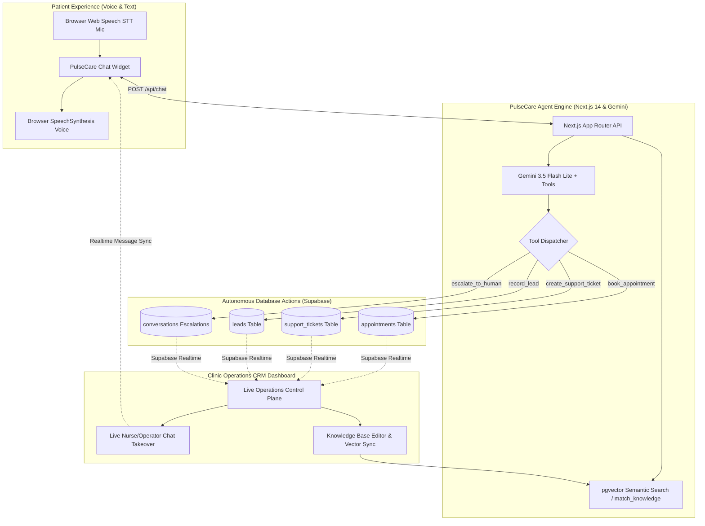

# PulseCare AI — Autonomous Healthcare Concierge & Clinic Operations Control Plane

> **Code E Fiesta 2026** · Problem Statement: **Action-Oriented Customer AI Agent**  
> An autonomous healthcare AI agent that interacts with patients across voice and chat, grounds medical and administrative answers using a dynamic semantic knowledge base, takes direct database and CRM actions (booking appointments, filing prescription refill tickets, capturing new patient leads), and escalates emergency triage to clinic staff with live real-time takeover.

---

## 🏛️ System Architecture



---

## 🌟 Why PulseCare AI?

| Problem in Healthcare Front-Desks | How PulseCare AI Solves It |
|---|---|
| **Unanswered Calls & Long Hold Times** | Immediate 24/7 multimodal voice & chat concierge answering questions within seconds. |
| **Administrative Staff Burnout** | Autonomously schedules doctor visits, generates refill tickets, and logs leads directly into Supabase. |
| **Refill & Billing Frustration** | Converts patient requests into structured, categorized tickets (`TCK-xxxx`) with priority tags. |
| **Dangerous Medical Delay** | Real-time emergency symptom triage flags urgent conditions, notifies staff, and enables instant human takeover. |
| **Outdated Static Chatbots** | Grounded in clinic knowledge via `pgvector` RAG, with an admin manager to add or edit FAQ articles on the fly. |

---

## ⚡ Autonomous Action Tools

PulseCare AI does not just produce conversational answers—it autonomously executes functions on the clinic database:

1. **`book_appointment`**:
   - Gathers patient details, preferred physician, specialty, date, and reason for consultation.
   - Inserts record into `appointments` table and produces an interactive booking confirmation card.
2. **`create_support_ticket`**:
   - Generates tracked tickets with unique IDs (`TCK-xxxx`) for prescription refills, billing inquiries, insurance verification, or lab records.
   - Assigns priority (`urgent`, `high`, `medium`, `low`) and saves directly to `support_tickets`.
3. **`record_lead`**:
   - Captures prospective patient or corporate wellness leads with source attribution (`chat`, `voice`, `referral`).
   - Inserts into `leads` table and assigns follow-up priority.
4. **`escalate_to_human`**:
   - Detects acute symptoms (chest pain, severe breathing issues) or explicit patient requests for human medical staff.
   - Flags conversation status as `escalated`, summarizes patient context, and enables live nurse intervention.

---

## 🖥️ Application Personas & Split-Screen Demo Mode

PulseCare AI features 3 viewing perspectives:

1. **Split-Screen Demo Mode (`/` with split toggle)**:
   - **Left:** Patient Chat & Voice interaction.
   - **Right:** Live Clinic Operations CRM with real-time reactive updates.
   - Perfect for live presentations, hackathon pitches, and side-by-side verification.
2. **Patient View**:
   - Dedicated clean healthcare concierge with suggestion chips, voice microphone input, voice audio playback, and inline action status cards.
3. **Clinic Operations CRM**:
   - **Appointments Calendar:** Real-time schedule of confirmed doctor visits.
   - **Support & Refill Tickets:** Categorized ticket board with status badges (`open`, `in_progress`, `resolved`).
   - **Patient Leads Pipeline:** Lead status management with one-click contact actions.
   - **Live Escalations & Nurse Cockpit:** Live chat feed with instant bidirectional nurse takeover.
   - **Knowledge Base Manager:** Add and edit clinic guidelines with automatic vector embedding sync.

---

## 🛠️ Tech Stack

- **Framework:** Next.js 14 (App Router, React 18, TypeScript)
- **Styling:** Tailwind CSS & Lucide React
- **Database & Realtime:** Hosted Supabase (PostgreSQL, Supabase Realtime Channels, `pgvector`)
- **LLM Reasoning & Function Calling:** `@google/genai` with `gemini-3.5-flash-lite` (Temperature 0.2, structured tool declarations)
- **Vector Embeddings:** Google GenAI `gemini-embedding-001` (768-dimensional embeddings)
- **Voice Capabilities:** Native Browser Web Speech API (`webkitSpeechRecognition` STT + `window.speechSynthesis` TTS)

---

## 🚀 Getting Started

### 1. Database Setup in Supabase
1. Open your Supabase project dashboard &rarr; **SQL Editor**.
2. Run the complete SQL schema script located in [`scripts/schema.sql`](scripts/schema.sql).
3. This creates all 6 tables (`conversations`, `messages`, `appointments`, `support_tickets`, `leads`, `knowledge_base`), sets up the `pgvector` index with the `match_knowledge` RPC function, enables Supabase Realtime publication, and seeds clinic knowledge base articles.

### 2. Environment Configuration
Create a `.env.local` file in the project root:

```bash
# Google Gemini API
GEMINI_API_KEY=your_gemini_api_key
GEMINI_MODEL=gemini-3.5-flash-lite
EMBEDDING_MODEL=gemini-embedding-001

# Supabase Configuration
NEXT_PUBLIC_SUPABASE_URL=https://your-project.supabase.co
NEXT_PUBLIC_SUPABASE_ANON_KEY=your_anon_key
SUPABASE_SERVICE_ROLE_KEY=your_service_role_key
```

### 3. Install & Run
```bash
# Install dependencies
npm install

# Run development server
npm run dev
```

Visit `http://localhost:3000` to interact with the application.

---

## ⏱️ 4-Minute Hackathon Demo Script

For a high-impact presentation, follow this sequence in **Split-Screen Demo Mode**:

1. **Minute 0:00 - The Problem & Architecture (30s)**
   - Show Split-Screen: Patient Chat on the left, Clinic Operations CRM on the right.
   - State the problem: Clinics lose patients to unanswered calls, hold times, and slow follow-ups. PulseCare AI turns conversations into autonomous actions.
2. **Minute 0:30 - Voice-Enabled Semantic Inquiry (45s)**
   - Click the mic icon or select the chip: *"What are your clinic hours and which insurances do you accept?"*
   - PulseCare AI retrieves clinic knowledge via `pgvector` RAG and speaks the answer aloud.
3. **Minute 1:15 - Autonomous Appointment Booking (45s)**
   - Send: *"I'd like to book an appointment with Dr. Reynolds for cardiology tomorrow at 10 AM. My name is Alex Rivera, 555-0199, alex@example.com, routine checkup."*
   - Watch Gemini execute `book_appointment`.
   - Point out the inline **Appointment Confirmation Card** on the left and the instant appearance of the appointment in the **Appointments** tab on the right.
4. **Minute 2:00 - Prescription Refill Ticket (45s)**
   - Send: *"I need a refill on my Atorvastatin prescription, 20mg. Patient ID #4829."*
   - Watch Gemini trigger `create_support_ticket`.
   - Point out the generated ticket code `TCK-xxxx` and switch to the **Tickets** tab on the right to see the new urgent ticket.
5. **Minute 2:45 - Emergency Triage & Live Nurse Takeover (60s)**
   - Send: *"I'm having severe crushing chest pain and shortness of breath for the last 20 minutes."*
   - PulseCare AI immediately flags emergency triage, issues safety guidance, and triggers `escalate_to_human`.
   - Switch to the **Live Escalations** tab in the CRM. Show the red emergency banner and clinical summary.
   - Type a nurse message from the CRM: *"Nurse Sarah here. Alex, sit down immediately. Paramedics have been dispatched to your location."*
   - Observe the nurse's message appear instantly on the patient's screen via Supabase Realtime.
6. **Minute 3:45 - Conclusion & Impact (15s)**
   - Highlight: Zero front-desk latency, 100% action traceability, and safe human-in-the-loop escalation.

---

## 📂 Project Directory Structure

```
├── app/
│   ├── api/
│   │   ├── appointments/route.ts   # Appointment REST endpoints
│   │   ├── chat/route.ts           # Gemini 3.5 Flash Lite + Tools agent
│   │   ├── escalate/route.ts       # Human takeover & escalation API
│   │   ├── knowledge/route.ts      # RAG vector sync & article management
│   │   ├── leads/route.ts          # Prospective patient lead API
│   │   └── tickets/route.ts        # Support & prescription ticket API
│   ├── globals.css                 # Tailwind custom themes
│   ├── layout.tsx                  # Root HTML wrapper
│   └── page.tsx                    # Persona & Split-Screen entrypoint
├── components/
│   ├── ClinicDashboard.tsx         # 5-Tab Clinic Operations CRM
│   └── PatientChat.tsx             # Multimodal voice & chat UI
├── lib/
│   ├── gemini.ts                   # Google GenAI client configuration
│   ├── knowledge.ts                # pgvector 768-dim semantic search
│   ├── supabase.ts                 # Supabase client & service instances
│   └── tools.ts                    # Autonomous Gemini tool execution
├── scripts/
│   └── schema.sql                  # Complete Supabase schema & initial seed
└── docs/
    └── prd.md                      # Comprehensive Product Requirement Doc
```
